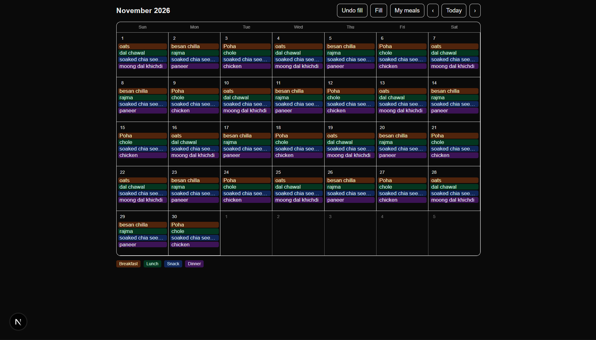

# Meal Calendar

A Google Calendar-style meal planner. Plan breakfast, lunch, snacks and dinner in advance, then open the app each morning and see exactly what you're eating.



## Features

- **Month calendar view.** Every date shows its meals as color-coded chips (breakfast, lunch, snack, dinner).
- **My meals list.** Save the meals you actually eat once, tagged by type, and pick from them when scheduling a day.
- **Click-to-plan.** Click any date to choose that day's meals from dropdowns.
- **Fill the calendar.** Rotate your saved meals across the next 7 days or the whole month in one click, with an undo button.
- **Saved automatically.** Your plan and meal list stay in your browser, so nothing is lost on refresh.
- **Light and dark mode.** Follows your system theme.

## Tech stack

- [Next.js](https://nextjs.org/) (App Router)
- React and TypeScript
- Tailwind CSS
- Browser `localStorage` for data (no backend yet)

## Getting started

```bash
git clone https://github.com/janhvee19/meal-calendar.git
cd meal-calendar
npm install
npm run dev
```

Then open [http://localhost:3000](http://localhost:3000).

## How to use

1. Click **My meals** and add the meals you eat, choosing a type for each (Breakfast, Lunch, Snack, Dinner or Any).
2. Click a date and pick that day's meals from the dropdowns, or click **Fill** to schedule a whole week or month automatically.
3. Use **Undo fill** if you don't like the result.

## Roadmap

- [ ] Week view with full meal names
- [ ] Sync across devices (Supabase)
- [ ] Installable on phones (PWA) with reminders
- [ ] Phone home-screen widget
- [ ] Browser extension showing today's and tomorrow's meals
- [ ] Grocery list generated from planned meals

## Author

Built by Janhvee Singh.